<p align="center">
  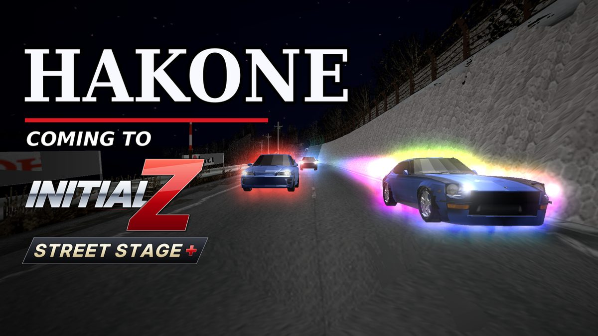
</p>

<h1 align="center">Initial Z: Street Stage+</h1>

<p align="center">
  <b>A full-scale fan remix of <i>Initial D Street Stage</i> (PSP, 2006) fused with <i>Wangan Midnight Portable</i> (PSP, 2007).</b><br>
  The Devil Z, Akio Asakura, a real Tokyo expressway, a real Hakone mountain road, 15 Wangan drivers, 7 Wangan cars,<br>
  an arcade-style aura system, a rewritten card system, a complete English translation and a brand-new opening movie.
</p>

<p align="center">
  58 builds · 35 release kits · ~370 KB of new MIPS code and data in the executable · 770+ Python tools · 230+ QA screenshots · 25 days
</p>

---

## What is Initial Z?

*Initial D Street Stage* is a Japan-only PSP touge racer. *Wangan Midnight Portable* is a Japan-only PSP highway racer from a different publisher and a different engine. **Initial Z** takes the first game apart, brings the soul of the second one into it, and puts it back together so that it plays as one game:

- Akio Asakura and the cursed **Devil Z** (Fairlady Z S30) arrive in Gunma, with a new **Devil Z Challenge** mode.
- A **Wangan night expressway** course built from Wangan Midnight Portable's own Shuto route data.
- A **Hakone** mountain course built from **real-world map and elevation data**.
- The Wangan drivers join Street Legends with their own progression and dialogue, and their own cars.
- Everything is in English.

It runs in PPSSPP (Windows and Android are tested) and patches only the player's own copy of the game.

<p align="center">
  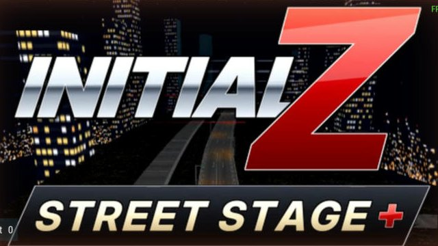
  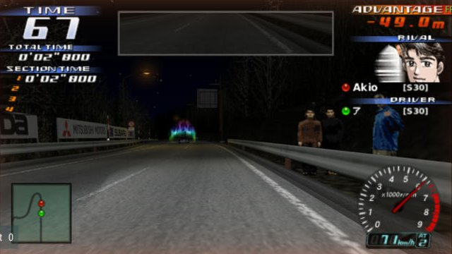
</p>

## Features

### The Devil Z and Akio
- **The Devil Z is its own car** in its own car slot, not a replacement. It has its own model, HUD tag, 9k tachometer, engine sound, physics and tuning, and it appears on the Nissan page once you beat Akio.
- **Devil Z Challenge**, a 9th main-menu mode: Akio in the blue Devil Z on every course, Wangan and Hakone included. It has its own talk scenes, course select and difficulty curve, and Akio is tuned to break the course records.
- **Akio in Street Legends** as an extra rival on every course, unlocked after Bunta, with his own win/loss record per course.

### Two new courses
- **Wangan**: about 6 km of Wangan Midnight Portable's Shuto expressway at night: a sweeping S-bend run, the Daikoku JCT with ramps and overpasses, then a 3 km straight. The centre line was rebuilt from WMP's lane ribbons, and WMP's scenery chunks were placed at their true positions. On top of that: new collision, AI lines, streaming sections, replay cameras, start grid, records, course maps and minimap, a lit skyline, sodium lamps and expressway gantries.
- **Hakone**: a 6 km stretch of the real **Hakone Turnpike**, uphill outbound and downhill return, with the big U-bend. The road comes from **OpenStreetMap**, the elevation from the **Copernicus GLO-30 DEM**, and the corners are banked like the stock roads. It has its own snow weather and its own lineup, and it appears in Time Attack, Street Legends, Versus and the Devil Z Challenge.

<p align="center">
  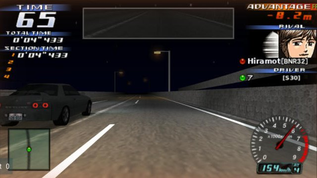
  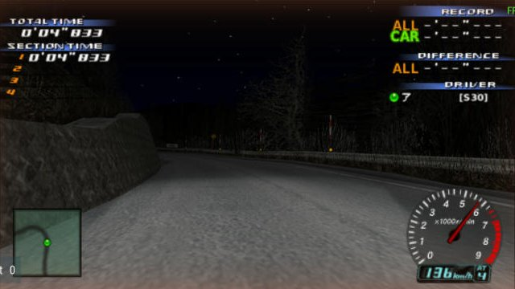
</p>

### The Wangan drivers
- **15 Wangan Midnight Portable drivers** in Street Legends: Hiramoto, Reina, Shima, Kuroki, Masaki and Ota of RGO, Eiji, and the rest. They appear on a second "Wangan Rivals" page on every course (L/R), with their own Wangan and Hakone lineups.
- Their art is WMP's own drawings, reframed and graded to sit next to Initial D's: rival-select faces, talk portraits, HUD faces and start cards.
- **Progression**: the Wangan drivers unlock after you beat Takumi on Akina, Akio after Bunta, and the Devil Z Challenge after your first win over Akio.
- **Dialogue rewritten for every scene**: first meeting, rematch, losing again, finally winning, retire. Lines react to your record against each driver, with no repeats between scenes.

<p align="center">
  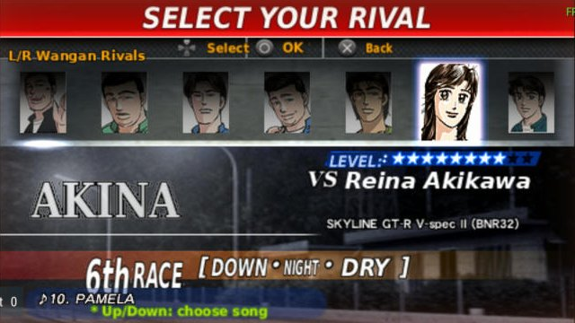
  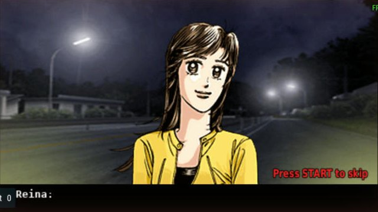
</p>

### Seven Wangan cars
- R33 GT-R, Supra (JZA80), 300ZX (Z32), 300ZX (Z31), Porsche 911 Turbo "Blackbird" (964), Celsior and Mark II, ported from WMP's models. Each has its own physics multipliers, paint, tach, HUD tag and parts list.
- You can buy them from a new **INITIAL Z** maker page and the Toyota page. The rivals drive them too: Shima races the black 964 and Kuroki the R33.

<p align="center">
  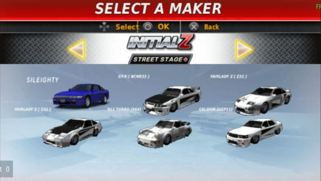
  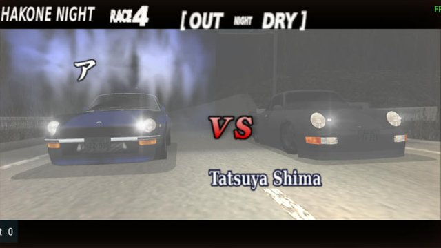
</p>

### The aura system
- **AURA TUNE**: spend Tune Up cards on 18 aura steps over six colours (Blue → White), each at three sizes. Every step adds top speed, +2 km/h by default and adjustable by cheat.
- **Legend auras in races**: Takumi blue, Bunta red (bigger at star level 15), Keisuke yellow, Ryosuke white, Akio a pulsing rainbow, and more. There's a big flare at the countdown, then a steady glow you race against.
- **New Game+ star auras**: each game clear makes every Street Legends rival's aura bigger, up to 7 stars.
- **Aura cards** drop only when you beat a driver who has an aura.
- **Rainbow Aura card**: beat Akio on all 10 Devil Z Challenge courses and your car gets Akio's rainbow.

<p align="center">
  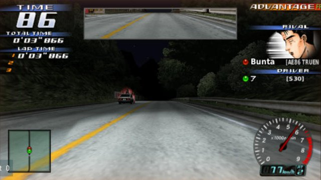
  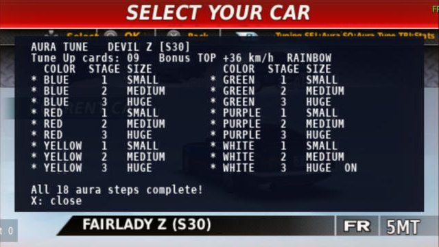
</p>
<p align="center">
  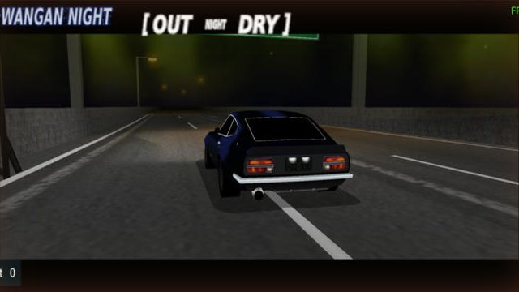
  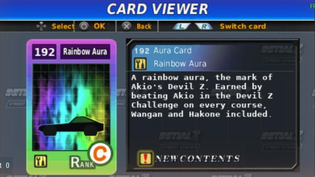
</p>

### Cards, translation, movie and more
- **Card screen rewritten**: real thumbnails, names, NEW and ×count tags, 10 cards on a win and 5 on a loss.
- **Complete English translation**: about 530 system messages, 4,891 rival talk lines across 826 scripts, about 300 re-lettered menu and HUD textures, the Card Collection, Project D Web, Versus, the ending and the save-data names. It uses a half-width talk font added through a code hook.
- **New opening movie**: rival vignettes over the Wangan night, Akio's hero shot, and an ending where the Devil Z leaves Bunta and Takumi behind. It's cut to the beat, with the song encoded into the movie as ATRAC3plus.
- **Snow on every course** in Time Attack and Versus, with snow grip and snow-covered scenery.
- **Music**: Wangan Midnight Portable's race tracks are selectable as race BGM.
- **Cheats**: a PPSSPP cheat file covering every unlock, plus tuning knobs (see [docs/CHEATS.md](docs/CHEATS.md)).

<p align="center">
  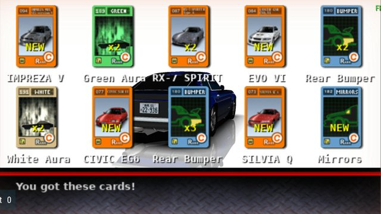
  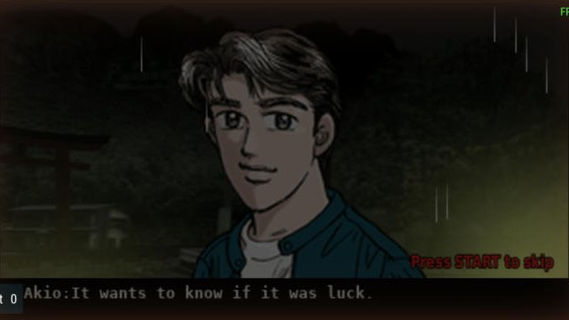
</p>

<p align="center">
  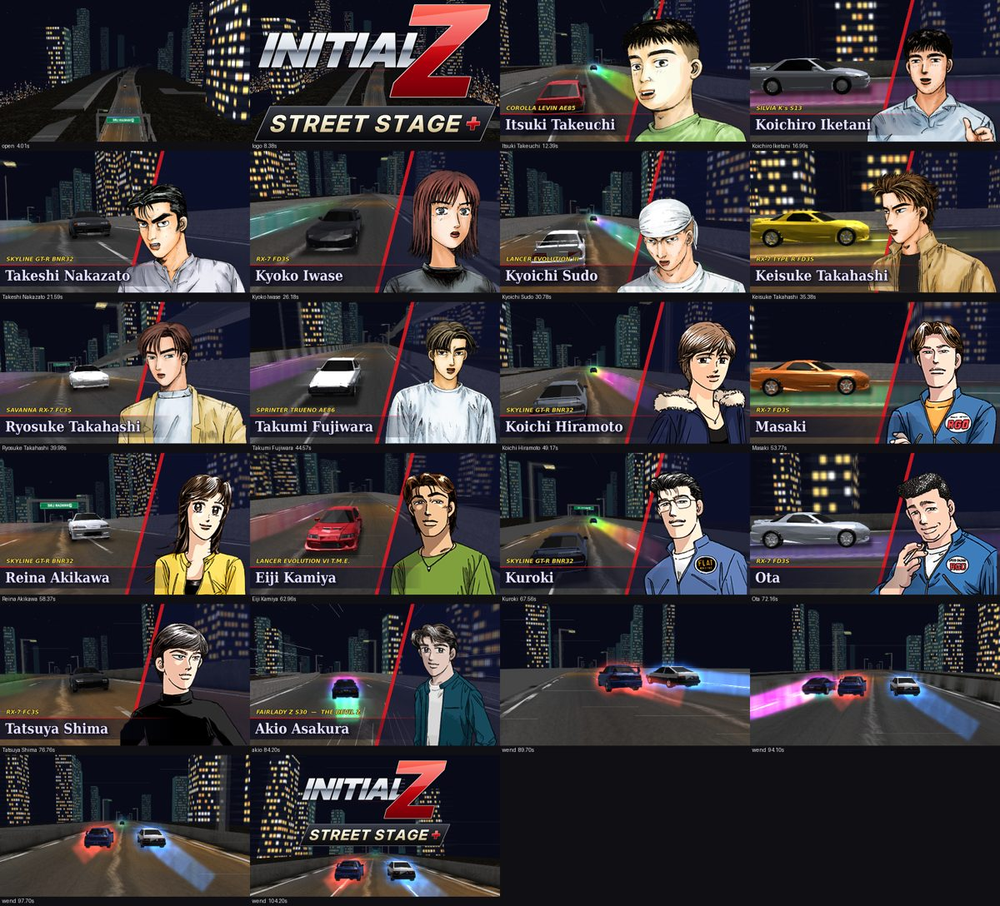
</p>

## How deep it goes

None of this used an official SDK or source code. Everything was worked out from the disc images:

| Layer | What it took |
|---|---|
| **Disc and file system** | ISO 9660 rebuilds that keep LBAs where possible. Reverse-engineered the game's own **`lba.dat` file table** and its **name hash** (found in the executable and reimplemented), so files can be added, not just replaced. |
| **Containers** | Sega's **XBB** archives (hash, alias entries, repacking), gzip layers that must keep their original headers, and Genki's **BUILD.DAT/UCL NRV2B** archive for Wangan Midnight Portable (a clean-room decompressor). |
| **Graphics** | **GIM** textures (palettes, swizzle), **GMO** models (rebuilt quantisation boxes, LODs, material/texture mapping) and Sega's **@ANA** 2D layout/animation format. Car ports, menus, cards and faces are built on these. |
| **Code** | Hand-written Allegrex **MIPS patches** in BOOT.BIN: new modes, course banks, a talk-script fix, AI, auras, cards and minimap hooks. They are chained per feature in reserved regions, with relocation-table updates. Every patch is checked by a **relocation simulator** and by running the game's own functions in **Unicorn** (97 emulation-based verify scripts). |
| **Courses** | Path, edge and AI lines, collision cells, streaming sections, LODs, start grids, replay cameras, AI speed tables and record slots, each one worked out by tracing the engine. Wangan was built from WMP's road ribbons; Hakone from **OpenStreetMap + DEM** geodata, with the stock scenery bent onto the new road, banked collision, and progress/streamer/game simulators to prove a course drives before it runs. |
| **Audio and video** | **PSMF** movies with a custom muxer, a silent ATRAC3plus stream, and then the song itself encoded into the movie. A custom **ATRAC3** encoder for the race songs. Found that LPCM and video-only PMFs hang the game. |
| **Text** | The talk-script grammar, reverse-engineered: it turned out English lines starting with a capital letter ran as script commands. Also SJIS strings, glyph atlases, a half-width font hook, and a grammar walker that checks every one of 1,210 talk tables. |

Some of the bugs that had to be found from first principles:
- Rivals stopped 400 m before the finish because a hidden per-course point limit was inherited from the course Wangan replaced.
- Sections vanished because of heap headroom.
- The SL course select hung on a 9-entry table read past its end.
- Talk went blank because English sentences such as "Not tonight." were run as script commands.

The full engineering log is in [docs/DEV_LOG.md](docs/DEV_LOG.md) and [docs/technical/](docs/technical/).

<p align="center">
  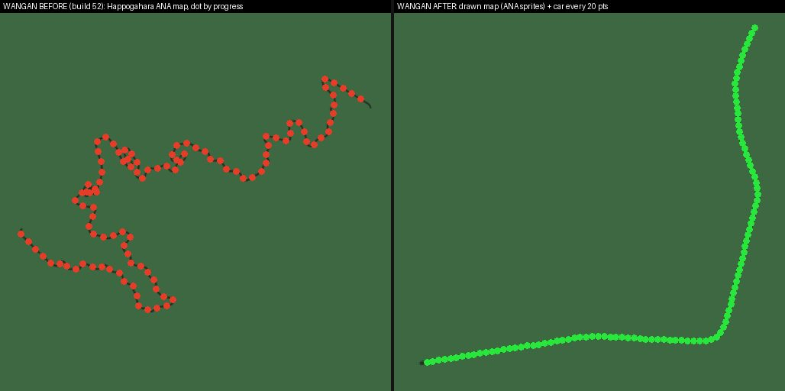
  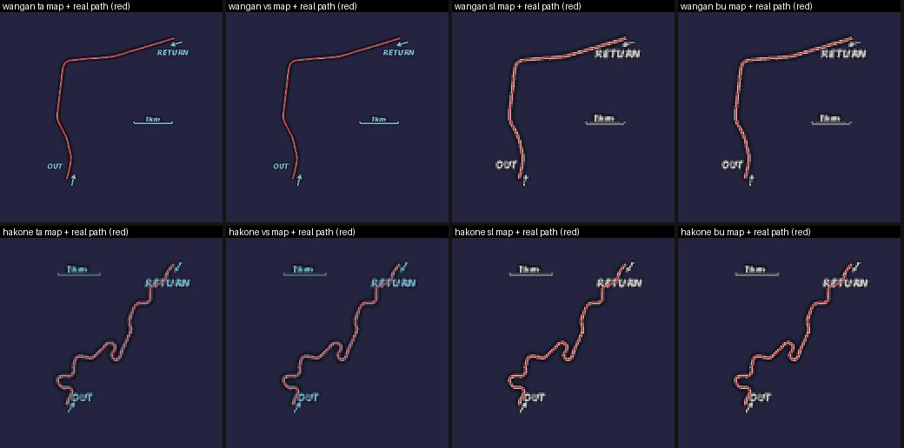
</p>

## By the numbers

| | |
|---|---|
| Builds | **58**, plus round-by-round QA builds |
| Release kits | **35** (each rebuilds a byte-exact ISO from the stock disc, MD5-verified) |
| Executable | Code and data segment grew from 2.33 MB to 5.68 MB on disk (the stock image already reserved room up to 5.33 MB in memory); about **370 KB** of new code and data sits in remix regions past the stock end |
| Files changed or added on the disc | **258** in the current build |
| Python tooling | **771** scripts, **~102,000** lines (format tools, builders, patchers, simulators, verifiers) |
| Verification | **85** dedicated verify scripts; the largest single run made 177,305 checks (car port) |
| QA | **233** PPSSPP QA screenshots across rounds; save data backed up and restored around every test |
| Timeline | **15 Oct 2026 → 9 Nov 2026** (25 days) |

## How it was made

Initial Z was made by **Daniel** ([@TheCoderFormerlyKnownAsAccountant](https://github.com/TheCoderFormerlyKnownAsAccountant)). He decided what the game should be, played every build and kept pushing on what felt wrong, from "Akio is too easy" to "the intro stutters" to "Shima's car doesn't match his intro card".

The work followed a fixed pipeline: decompile, reverse-engineer the formats, patch the code, mix in the Wangan assets, translate, recompile and test. Features were built in parallel, each in its own reserved region of the executable, then merged byte-by-byte and verified. Every build was tested in **PPSSPP**, with the save backed up and restored around every test.

## Playing it

This repository contains **only original code, documentation and screenshots**. It does not contain any game data.

To play, you need your own legally obtained copy of *Initial D Street Stage* (ULJM05093). Grab the **clean install kit** from the [Releases](../../releases) page. It contains no game data: it rebuilds Initial Z on your computer from your own copies of *Initial D Street Stage* (ULJM05093) and *Wangan Midnight Portable* (ULJM05264). See the [v1.0 release notes](docs/release/RELEASE_NOTES_v1.0.md). See [docs/CHEATS.md](docs/CHEATS.md) for the cheat file.

**Akio too hard?** Street Legends Akio is tuned to world-record pace, and on Wangan and Hakone he is faster still. If he's out of reach, turn on the **Easier Akio** codes in the [cheat file](docs/CHEATS.md): one each for Wangan and Hakone, plus **no slipstream**, which stops him matching your speed. These codes don't touch your save, so you can turn them off at any time. A retune of Akio is planned for v1.1.

PPSSPP tips: turn off the on-screen chat button (it covers speaker names). On slower devices, keep the default rendering settings.

## Repository layout

```
docs/
  DEV_LOG.md            the full engineering log, build by build
  BUILD_HISTORY.md      a readable summary of all 58 builds
  FORMATS.md            PSP formats as we came to understand them
  DIALOGUE.md           how the dialogue was audited and rewritten
  CHEATS.md, cheats/    the player cheat file and what each code does
  technical/            deep dives: Wangan route, Hakone, WMP drivers and cars,
                        snow, minimaps, auras, cards, movie audio, the talk bug
  img/                  screenshots
lib/                    general PSP format tools (ISO, XBB, GIM, GMO, @ANA, UCL, MIPS)
tools/                  project-specific tools: course builders and simulators,
                        movie pipeline, ATRAC3 encoder, talk grammar, BOOT patch
                        scripts and their verifiers
```

The tools expect a workspace with `game/` (files extracted from your own disc) and `work/` (intermediate output). They are published as a record of how the work was done, so some are tied to specific build steps.

## Credits

- *Initial D Street Stage* © SEGA 2006. *Initial D* © Shuichi Shigeno / Kodansha.
- *Wangan Midnight Portable* © Genki / Namco Bandai. *Wangan Midnight* © Michiharu Kusunoki / Kodansha.
- Hakone road data © [OpenStreetMap](https://www.openstreetmap.org/copyright) contributors, ODbL 1.0.
- Elevation produced using Copernicus WorldDEM-30 © DLR e.V. 2010–2014 and © Airbus Defence and Space GmbH 2014–2018, provided under COPERNICUS by the European Union and ESA.
- [atracdenc](https://github.com/dcherednik/atracdenc) (LGPL) for ATRAC3plus encoding. [Unicorn](https://www.unicorn-engine.org/) for CPU emulation. [PPSSPP](https://www.ppsspp.org/) for testing. FFmpeg, x264, NumPy and Pillow throughout.
- The "Initial Z" logo, the Hakone and Wangan course builds, the dialogue for Akio and the Wangan drivers, and all tools here are original work.

## Disclaimer

Initial Z is an unofficial, non-commercial fan project. It is not affiliated with, endorsed by or connected to SEGA, Namco Bandai, Genki, Kodansha or the creators of *Initial D* and *Wangan Midnight*. All trademarks belong to their owners. No game code, data or assets are distributed in this repository.

## License

Original code and documentation: [MIT](LICENSE). This does not cover the games or any content derived from them.
